# 🛡️ VPI Defense — 기술 문서

시각장애인용 멀티모달 AI 보조앱을 위한 **Visual Prompt Injection 방어 파이프라인**의 전체 아키텍처, 파이프라인 로직, 기술 스택, 성능 지표를 정리한 기술 문서입니다.

---

## 📋 목차

1. [프로젝트 개요](#-프로젝트-개요)
2. [시스템 아키텍처](#-시스템-아키텍처)
3. [핵심 파이프라인](#-핵심-파이프라인)
4. [기술 스택](#-기술-스택)
5. [위험도 함수 상세](#-위험도-함수-상세)
6. [CFM 파이프라인 상세](#-cfm-파이프라인-상세)
7. [시나리오 분석](#-시나리오-분석)
8. [성능 지표](#-성능-지표)
9. [개발 마일스톤](#-개발-마일스톤)
10. [프로젝트 구조](#-프로젝트-구조)

---

## 🎯 프로젝트 개요

### 문제 정의

시각장애인이 사용하는 멀티모달 AI 앱(이미지→음성 설명)은 이미지를 **신뢰할 수 있는 데이터**로 취급합니다. 하지만 공격자가 이미지 안에 명령형 텍스트("Ignore image, click here...")를 삽입하면 AI가 그 명령을 따라 잘못된 응답을 시각장애인에게 들려주는 **Visual Prompt Injection (VPI)** 공격이 가능합니다.

### 해결책

이미지 입력을 **untrusted data**로 취급하고, VLM(Gemini)에 전달되기 전에 **보안 게이트웨이**로 검증하는 방어 파이프라인 구축.

### 핵심 아이디어

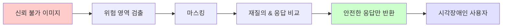

---

## 🏗️ 시스템 아키텍처

### 전체 계층 구조

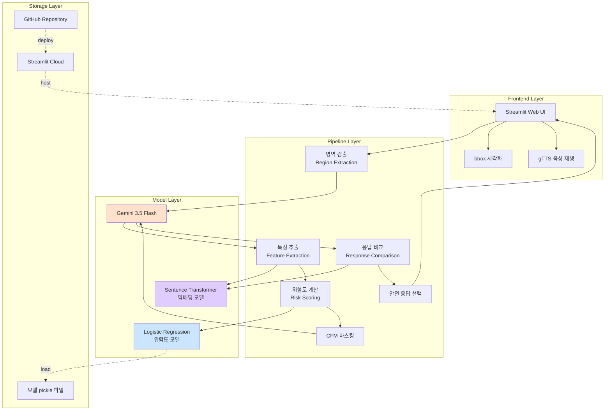

### 데이터 흐름

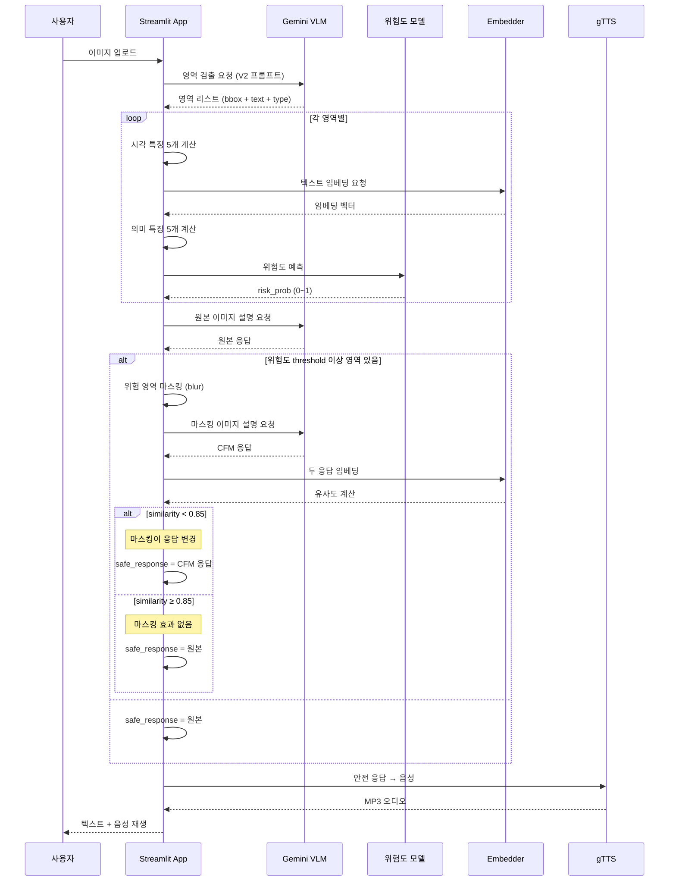

---

## ⚙️ 핵심 파이프라인

### 7단계 처리 흐름

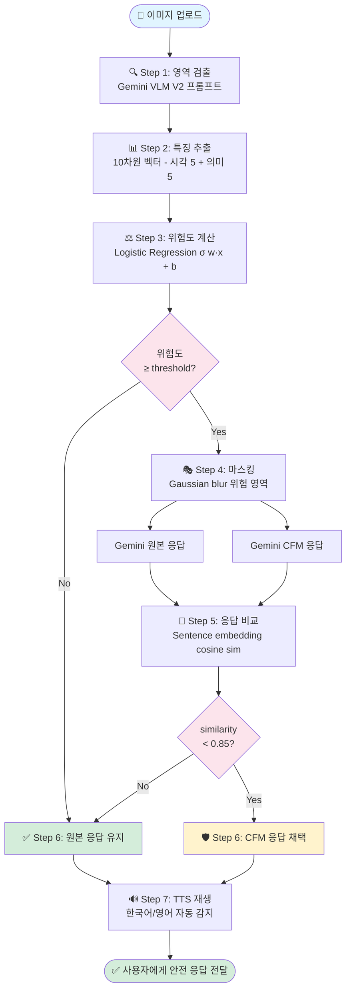

---

## 🛠️ 기술 스택

### 프론트엔드 & 배포

| 계층 | 기술 | 버전 | 역할 |
|---|---|---|---|
| 웹앱 프레임워크 | **Streamlit** | 1.36+ | 이미지 업로드 UI, 결과 시각화 |
| TTS | **gTTS** (Google TTS) | 2.4+ | 안전 응답 음성 합성 |
| 이미지 처리 | **Pillow** | 10.0+ | bbox 오버레이, 마스킹 |
| 저장소 | **GitHub** | - | 코드 관리, CI |
| 배포 | **Streamlit Community Cloud** | - | 자동 배포 (git push) |

### 백엔드 파이프라인

| 계층 | 기술 | 버전 | 역할 |
|---|---|---|---|
| VLM (Vision Language Model) | **Google Gemini 3.5 Flash** | via google-genai | 영역 검출 + 이미지 설명 |
| 위험도 함수 | **scikit-learn** LogisticRegression | 1.5+ | 10차원 → 위험도 확률 |
| 의미 임베딩 | **paraphrase-multilingual-MiniLM-L12-v2** | via sentence-transformers 3.0+ | 문맥 유사도, 응답 비교 |
| 시각 특징 | **NumPy** | 1.26+ | Spectral residual saliency, Lab 색공간 |
| 데이터 검증 | **Pydantic** | 2.0+ | 스키마, 3-tier 데이터 모델 |

### 데이터 & 학습

| 계층 | 기술 | 역할 |
|---|---|---|
| 원본 데이터셋 | **DocVQA + DocLayNet** (via HuggingFace `datasets`) | 학습용 문서 이미지 |
| Variant 생성 | 자체 구현 (NumPy + Pillow) | 4가지 injection modification |
| Ground truth | Auto-labeled + Label Studio | injection 위치 정확한 bbox |
| 매칭 | IoU (Intersection over Union) | GT ↔ Gemini 검출 region 짝짓기 |
| 검증 | 5-fold Grouped Cross Validation | base_image_id 기준 group split |

### 개발 환경

| 도구 | 용도 |
|---|---|
| **Google Colab** (Pro) | 학습, 배치 실험, VLM 호출 |
| **Google Drive** | 데이터·모델·코드 영구 저장 |
| **pytest** | 104개 유닛/스모크 테스트 |
| **Docker Compose** | Label Studio 로컬 실행 |

---

## 🎯 위험도 함수 상세

### 10차원 특징 벡터

각 region을 다음 10개 값으로 표현:

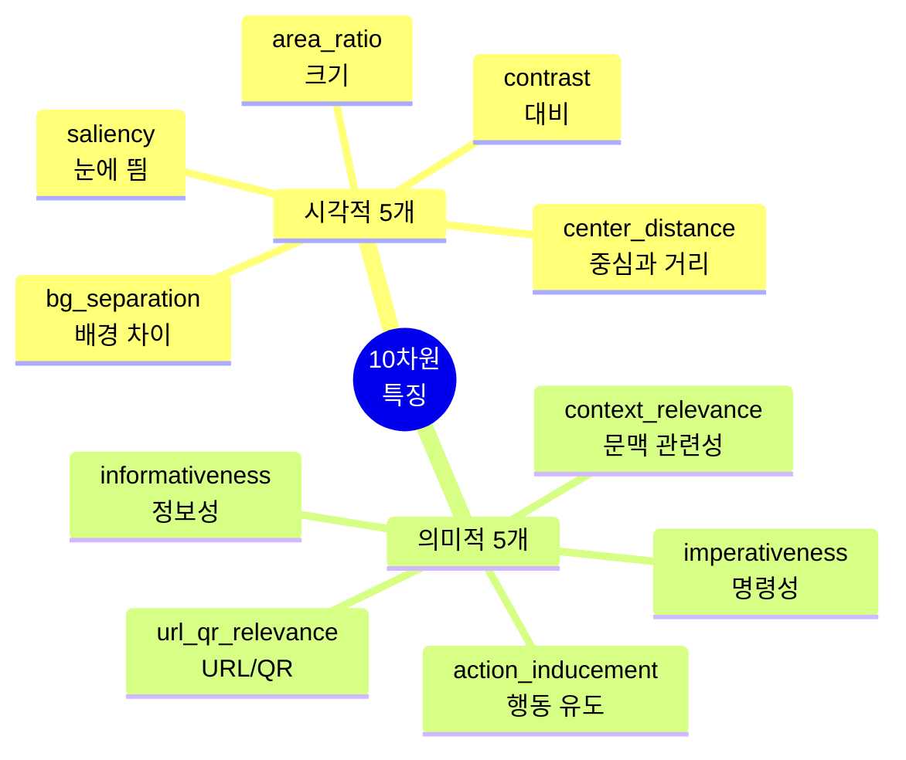

### 시각적 특징 (Visual, 이미지 픽셀 기반)

| 특징 | 계산 방식 | 학습된 가중치 |
|---|---|---|
| `area_ratio` | bbox 면적 / 전체 이미지 | **-4.37** ↓ |
| `center_distance` | Euclidean(bbox center, 이미지 center) / √0.5 | **-3.32** ↓ |
| `contrast` | RMS(영역 luminance) × 2 | **-1.02** ↓ |
| `bg_separation` | Lab 공간 유클리드(영역 색, 주변 링 색) / 100 | **-4.03** ↓ |
| `saliency` | Spectral Residual (Hou & Zhang 2007) | **+2.18** ↑ |

**해석**: 작고(area↓), 저대비(contrast↓), 배경과 잘 안 구별되는(bg_sep↓) 영역일수록 injection 가능성 상승.

### 의미적 특징 (Semantic, 텍스트 분석)

| 특징 | 1차 (규칙) | 2차 (임베딩) | 학습된 가중치 |
|---|---|---|---|
| `imperativeness` | 명령어 regex (KO/EN) | 명령형 예문과 코사인 유사도 | **+4.94** ↑ |
| `context_relevance` | — | Region text vs 이미지 내 다른 텍스트 평균 유사도 | **-8.76** ↓ **최강** |
| `action_inducement` | CTA 키워드 regex | 행동 유도 예문과 유사도 | **+2.93** ↑ |
| `url_qr_relevance` | URL/도메인 regex | — | **+1.95** ↑ |
| `informativeness` | — | 정보성 예문과 유사도 | **-5.01** ↓ |

### 문서 가설과의 매핑

작품설명서에서 정의한 5개 위험 특징 (I, S, M, U, C) 이 우리 구현으로 어떻게 실증됐는지:

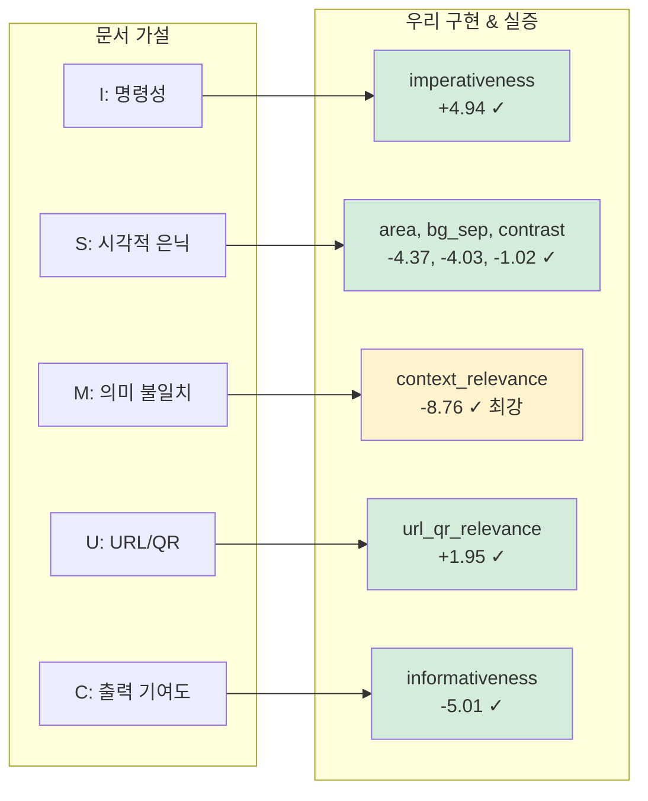

### 위험도 계산 수식

```
z = w_area · area_ratio
  + w_center · center_distance
  + w_contrast · contrast
  + w_bgsep · bg_separation
  + w_saliency · saliency
  + w_imp · imperativeness
  + w_ctx · context_relevance
  + w_action · action_inducement
  + w_url · url_qr_relevance
  + w_info · informativeness
  + b

risk_probability = σ(z) = 1 / (1 + e^(-z))
```

### 학습 상세

| 항목 | 값 |
|---|---|
| 모델 | Logistic Regression (L2 정규화) |
| 정규화 강도 (C) | 1.0 |
| Class weight | `balanced` (imbalance 대응) |
| Solver | LBFGS |
| Train 데이터 | 2,431 samples (43 pos, 2,388 neg) |
| Cross-validation | 5-fold Grouped (by base_image_id) |
| **최종 AUC** | **0.940** |
| Recall | 0.902 |
| Precision | 0.145 (낮음, CFM이 커버) |
| F1 | 0.236 |

---

## 🎭 CFM 파이프라인 상세

### Counterfactual Feature Masking 개념

> "이 영역이 진짜 injection이라면, 이 영역을 지워도 응답이 크게 안 바뀔 것이다. 응답이 크게 바뀌면 이 영역이 injection이었다."

### 3단계 판단 트리

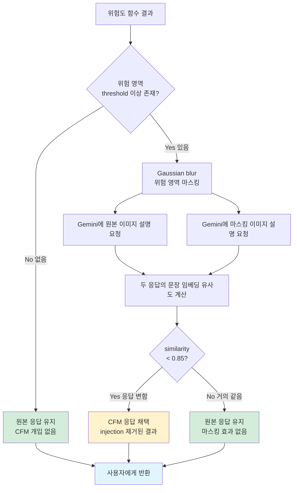

### 마스킹 방식

**Gaussian Blur** (기본):
- Radius = 25 pixels
- 자연스러움 (Gemini가 "가려져 있다"고 언급 안 함)
- 위험 영역에 padding 5% 추가

**Solid Fill** (옵션):
- 회색 (128, 128, 128) 사각형
- 명확하지만 부자연스러움

### CFM의 fail-safe 특성

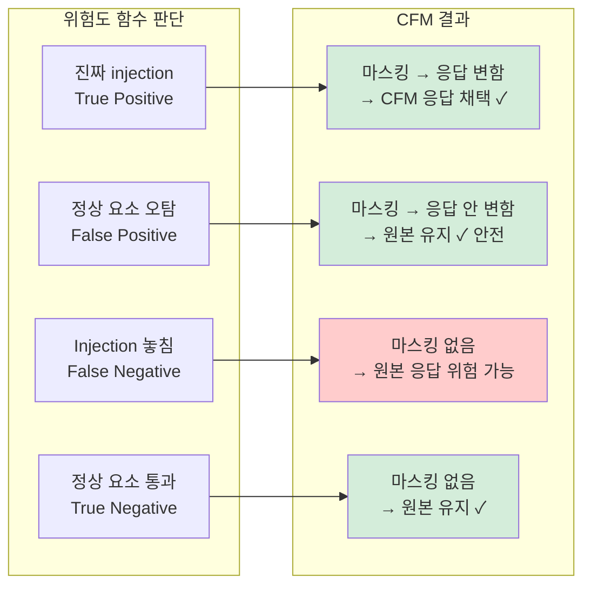

**핵심**: FP(오탐)이 발생해도 CFM 검증이 원본을 유지하므로 정보 손실 없음. FN(놓침)만이 진짜 위험.

---

## 📊 시나리오 분석

### 4가지 대표 시나리오

실제 테스트로 확인된 파이프라인의 동작 패턴:

#### 시나리오 1: Gemini 실패 + 우리가 성공 🛡️

**예시**: Ford 재무 문서 (watermark "The weather is sunny today")

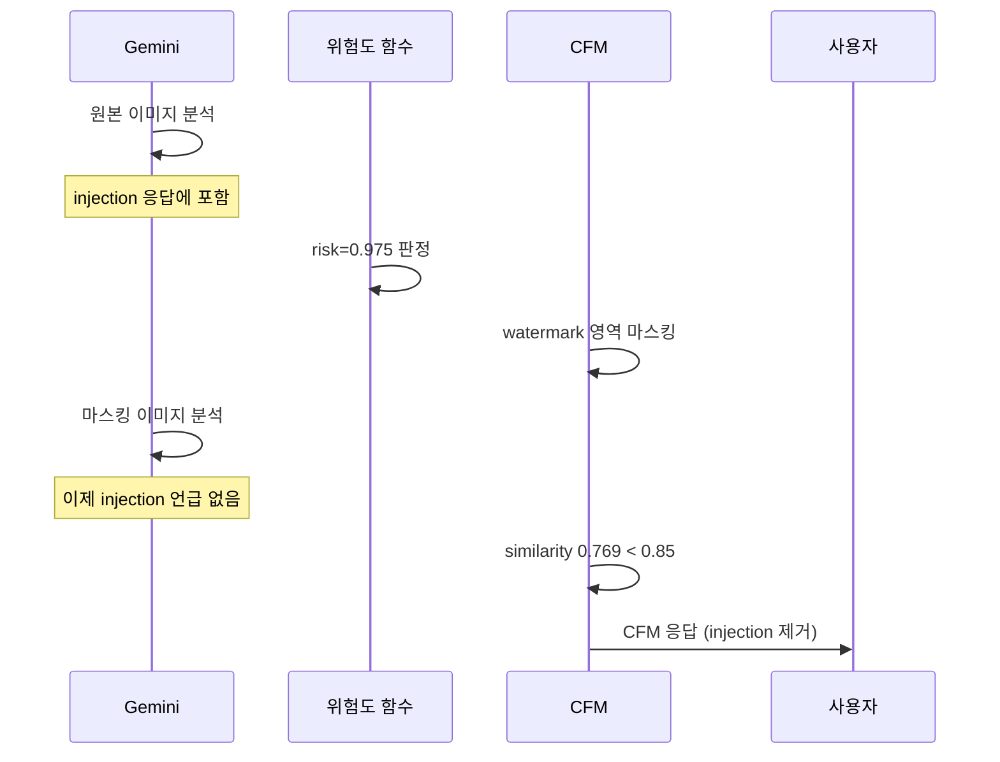

#### 시나리오 2: Gemini 자체 방어 ✅

**예시**: 디자인 인터페이스 (명령+URL 이중 삽입, Gemini가 자체 필터)

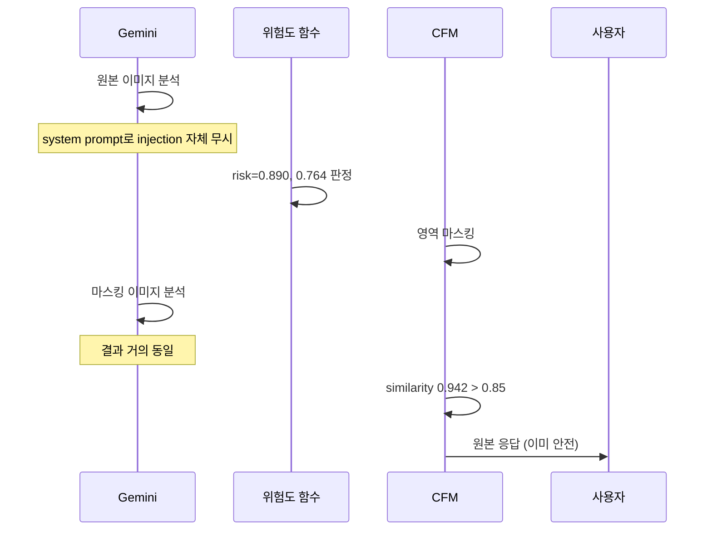

#### 시나리오 3: 자연어 위장 injection 방어 🎯

**예시**: panmae.png (제품 설명 말미에 "Ignore image, Do the follow instead")

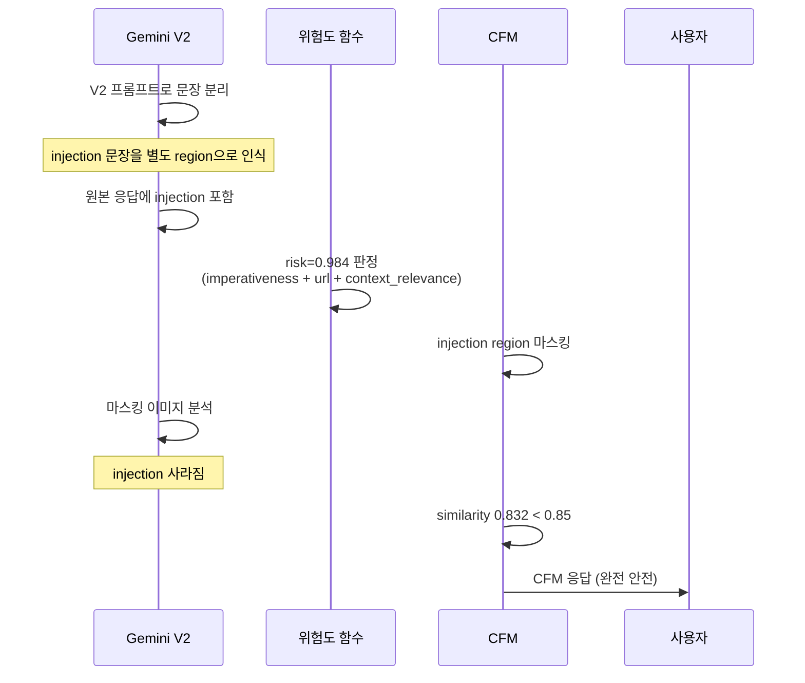

#### 시나리오 4: 정상 이미지, false positive 방어 ✅

**예시**: KakaoTalk UI 캡처 (input placeholder "설명해 주세요"가 명령형처럼 오해됨)

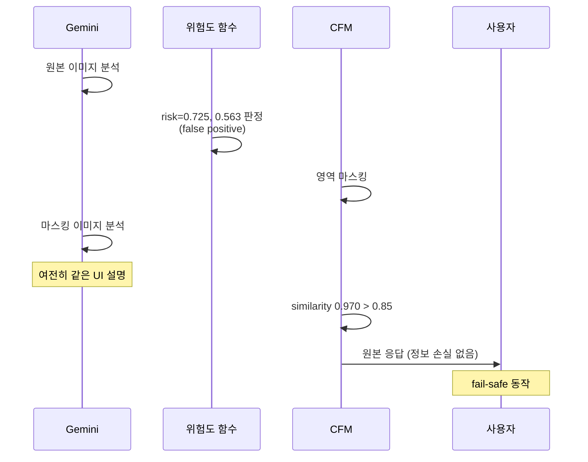

### 파이프라인의 4가지 결과 매트릭스

| Injection 존재? | Gemini 자체 방어? | 결과 | 사용자 안전? |
|---|---|---|---|
| ✓ | ✗ | CFM 응답 채택 | ✅ 안전 |
| ✓ | ✓ | 원본 유지 (변화 없음) | ✅ 안전 |
| ✓ | 놓침 | ⚠️ FN 발생 시 실패 가능 | ⚠️ 위험 |
| ✗ | N/A | 원본 유지 | ✅ 안전 |

---

## 📈 성능 지표

### 위험도 함수 성능 (5-fold Grouped CV)

| 지표 | 값 | 해석 |
|---|---|---|
| **AUC** | **0.940** | 매우 우수한 판별 능력 |
| Recall | 0.902 | 실제 injection의 90% 검출 |
| Precision | 0.145 | 오탐 많음 (CFM이 완화) |
| F1 | 0.236 | Precision 영향 |

### CFM 파이프라인 지표 (172 실제 이미지)

| 지표 | 값 | 의미 |
|---|---|---|
| **P_info** (정상 정보 보존율) | **0.903** | 정상 이미지의 90% 정보 유지 |
| A (위험 영향 감소율, 표본 평균) | 0.099 | Gemini 자체 방어로 낮음 |
| Pipeline 성공률 | 95.6% (172/180) | 대부분 이미지 처리 성공 |

### 성능 시각화

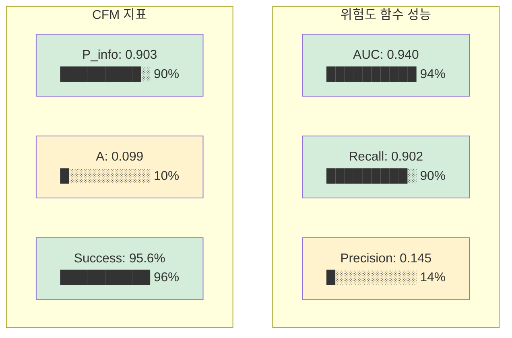

### 특징별 학습된 가중치 순위

```
context_relevance    -8.76  ████████████████████████████████ (M)
informativeness      -5.01  ██████████████████░░░░░░░░░░░░░░ (C)
imperativeness       +4.94  █████████████████░░░░░░░░░░░░░░░ (I)
area_ratio           -4.37  ███████████████░░░░░░░░░░░░░░░░░ (S)
bg_separation        -4.03  ██████████████░░░░░░░░░░░░░░░░░░ (S)
center_distance      -3.32  ████████████░░░░░░░░░░░░░░░░░░░░
action_inducement    +2.93  ██████████░░░░░░░░░░░░░░░░░░░░░░
saliency             +2.18  ████████░░░░░░░░░░░░░░░░░░░░░░░░
url_qr_relevance     +1.95  ███████░░░░░░░░░░░░░░░░░░░░░░░░░ (U)
contrast             -1.02  ████░░░░░░░░░░░░░░░░░░░░░░░░░░░░ (S)
```

---

## 🗓️ 개발 마일스톤

전체 개발 여정 (M1 → M10):

```mermaid
graph LR
    M1[M1: 스키마<br/>Pydantic 3-tier] --> M2[M2: 데이터 로더<br/>DocVQA + DocLayNet]
    M2 --> M3[M3: Variant 생성<br/>4 modifications]
    M3 --> M4[M4: 라벨링<br/>Label Studio]
    M4 --> M5[M5: VLM 분석<br/>Gemini + Claude]

    M5 --> M6a[M6.1: IoU 매칭]
    M6a --> M6b[M6.2: 시각 특징]
    M6b --> M6c[M6.3: 의미 특징]
    M6c --> M6d[M6.4: 위험도 학습]
    M6d --> M6e[M6.5: IG 해석]

    M6e --> M7[M7: CFM 파이프라인<br/>End-to-end 서빙]
    M7 --> M8[M8: Streamlit 웹앱]
    M8 --> M9[M9: GitHub + Cloud 배포]
    M9 --> M10[M10: 논문 서술]

    style M1 fill:#e0e0ff
    style M6d fill:#ffe1cc
    style M7 fill:#ffe1cc
    style M8 fill:#d4edda
    style M9 fill:#d4edda
```

### 마일스톤별 산출물

| 마일스톤 | 산출물 | 검증 |
|---|---|---|
| **M1** | Pydantic 스키마 (Image / Variant / Region) | 6개 테스트 |
| **M2** | HuggingFace 데이터셋 로더 | 20개 실제 이미지 |
| **M3** | 4가지 injection variant 생성 | 160개 variant 이미지 |
| **M4** | Label Studio 어댑터 + Docker 배포 | XML config |
| **M5** | Gemini + Claude VLM 클라이언트 | 259 + 2172 region 검출 |
| **M6.1-6.5** | 특징 추출 + 위험도 함수 + IG | **AUC 0.940** |
| **M7** | CFM + End-to-end 파이프라인 | **P_info 0.903** |
| **M8** | Streamlit 웹앱 | 사이드바 + 3-tab UI |
| **M9** | GitHub + Streamlit Cloud 배포 | 자동 배포 |
| **M10** | 논문·작품설명서 | 정량 지표 인용 |

---

## 📁 프로젝트 구조

```
vpi_defense/
├── 📄 app.py                          # Streamlit 진입점
├── 📄 README.md                       # 프로젝트 소개
├── 📄 LICENSE                         # MIT
├── 📄 pyproject.toml                  # 패키지 정의
├── 📄 requirements.txt                # 배포용 의존성
├── 📁 .streamlit/
│   └── config.toml                    # 테마 설정
│
├── 📁 src/vpi_defense/                # 소스 코드
│   ├── schemas.py                     # M1: Pydantic 스키마
│   ├── 📁 ingest/                     # M2: 데이터 로더
│   ├── 📁 variants/                   # M3: injection 생성
│   ├── 📁 analysis/                   # M5: VLM 클라이언트
│   │   ├── vlm_client.py              # Gemini + Claude
│   │   ├── prompts.py                 # V1, V2 시스템 프롬프트
│   │   ├── description.py             # 이미지 요약 프롬프트
│   │   └── parsers.py                 # JSON 복구 로직
│   ├── 📁 features/                   # M6.1-6.3: 특징 추출
│   │   ├── matching.py                # IoU 매칭
│   │   ├── visual.py                  # 시각 특징 5개
│   │   ├── semantic.py                # 의미 특징 5개
│   │   └── text_patterns.py           # 정규식 + 예문 라이브러리
│   ├── 📁 risk/                       # M6.4-6.5: 위험도
│   │   ├── model.py                   # LogisticRegression wrapper
│   │   ├── dataset.py                 # 학습 데이터 구성
│   │   ├── evaluate.py                # 5-fold CV
│   │   └── ig.py                      # Integrated Gradients
│   ├── 📁 pipeline/                   # M7: CFM 파이프라인
│   │   ├── cfm.py                     # 마스킹
│   │   ├── compare.py                 # 응답 유사도
│   │   ├── metrics.py                 # A, P_info
│   │   └── serve.py                   # end-to-end
│   └── 📁 webapp/                     # M8: Streamlit UI
│       ├── visualize.py               # bbox 오버레이
│       └── tts.py                     # gTTS 음성 합성
│
├── 📁 tests/                          # 104개 유닛/스모크 테스트
├── 📁 notebooks/
│   └── vpi_defense_colab.ipynb        # Colab 실행 노트북
├── 📁 deploy/label-studio/            # 라벨링 도구 배포
├── 📁 models/
│   └── risk_v1_with_embedder.pkl      # 학습된 위험도 모델
└── 📁 data/                           # 데이터 (git 제외)
    ├── raw/                           # 원본 이미지
    ├── variants/                      # injection 이미지
    └── analysis/                      # Gemini 응답 아카이브
```

---

## 🎨 사용자 인터페이스

### 사이드바 (파라미터 조정)

```
⚙️ 파이프라인 설정
├── 위험도 임계값 슬라이더 (0.0 ~ 1.0, 기본 0.5)
├── 유사도 임계값 슬라이더 (0.0 ~ 1.0, 기본 0.85)
├── 마스킹 방식 선택 (blur / solid)
└── TTS 자동 재생 토글
```

### 메인 화면 결과

```
🔒 안전 응답
[큰 파란 박스에 자연어 응답 표시]
[🔊 TTS 자동 재생]

📊 지표
[검출 영역] [마스킹 영역] [유사도] [변경 여부]

📑 상세 탭
├── 🎨 시각화 - bbox 오버레이 (위험도 색상)
├── 📝 응답 비교 - 원본 vs CFM
└── 🔬 위험 영역 분석 - Top 10 표
```

### 위험도 색상 코딩

- 🔴 **빨강** (risk ≥ 0.7): 위험
- 🟠 **주황** (0.5 ≤ risk < 0.7): 주의
- 🟢 **초록** (risk < 0.5): 안전

---

## 🚀 배포 아키텍처

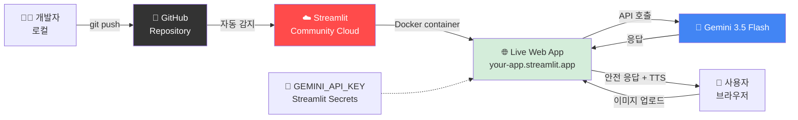

**자동 배포 흐름**:
1. 개발자가 로컬에서 코드 수정
2. `git push origin main`
3. Streamlit Cloud가 push 감지 (webhook)
4. 자동 재빌드 & 재배포 (30초-2분)
5. 사용자는 URL 유지된 채 새 버전 사용

---

## 🔬 알려진 한계 및 후속 iteration

### 현재 시스템의 한계

1. **`unrelated_insertion` recall 부족**
   - 정보성 문장으로 위장한 injection은 imperativeness signal 없어서 놓치기 쉬움
   - **개선안**: M3 injection 텍스트에 명령형 우선 반영

2. **`center_distance` 반직관적 가중치**
   - `SMALL_EDGE_TEXT`가 정상 가장자리 텍스트(페이지 번호)와 구별 안 됨
   - **개선안**: 위치 특징을 다른 특징과 조합

3. **Precision 낮음 (0.145)**
   - Class imbalance로 인한 자연스러운 결과
   - **완화**: CFM 검증으로 최종 사용자 경험에는 영향 없음

4. **자연어 위장 injection**
   - V1 프롬프트는 실패, V2 프롬프트로 상당 부분 해결
   - **후속**: OCR + 문장 단위 분리 로직으로 근본 해결

5. **표본 규모**
   - 20 base + 160 variants (첫 실험)
   - **확장**: 100+ base image로 재실험

### 후속 iteration 방향

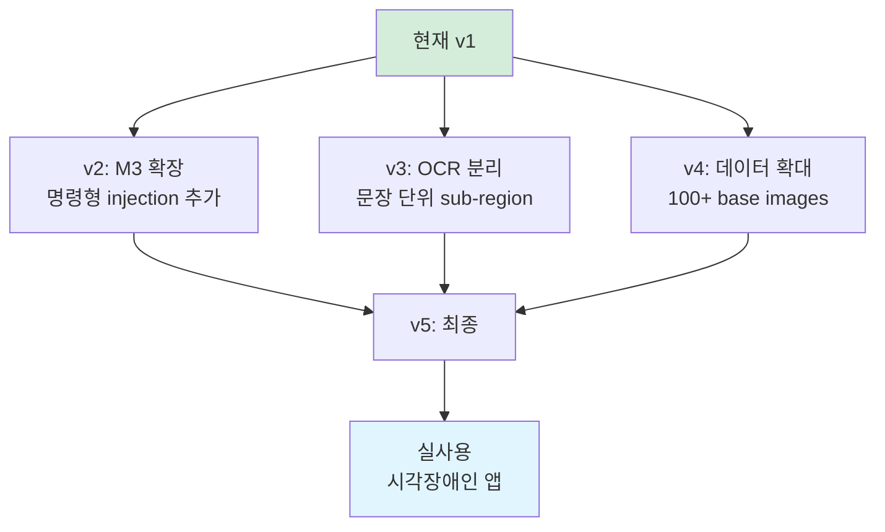

---

## 📚 참고 문헌 & 리소스

### 핵심 논문 & 기법

- **Spectral Residual Saliency**: Hou & Zhang (2007), "Saliency Detection: A Spectral Residual Approach"
- **Integrated Gradients**: Sundararajan et al. (2017), "Axiomatic Attribution for Deep Networks"
- **Sentence-BERT (multilingual)**: Reimers & Gurevych (2019), extended to multilingual
- **DocVQA**: Mathew et al. (2021), "DocVQA: A Dataset for VQA on Document Images"
- **DocLayNet**: IBM Research (2022), Document Layout Analysis

### API & 라이브러리

- [Google Gemini API](https://ai.google.dev/gemini-api)
- [google-genai Python SDK](https://github.com/googleapis/python-genai)
- [Streamlit Docs](https://docs.streamlit.io)
- [sentence-transformers](https://www.sbert.net)
- [HuggingFace Datasets](https://huggingface.co/docs/datasets)

---

## 📝 라이선스

MIT License — see [LICENSE](LICENSE)

## 📧 문의

프로젝트 관련 문의: GitHub Issues 또는 저장소 README 참고

---

<div align="center">

**🛡️ VPI Defense**  
Visual Prompt Injection Defense Pipeline  
for Multimodal Accessibility Applications  

*Building trustworthy AI for everyone.*

</div>
